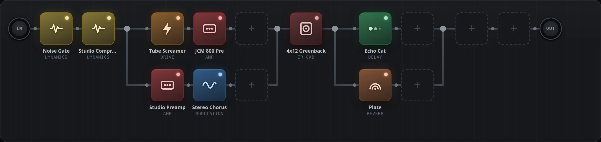

# Alice

[English](README.md) · **Italiano** · [Sito](https://teopost.github.io/alice/)

Multi-effetto per chitarra open source con interfaccia web, pensato per pedaliere fatte in casa
(Raspberry Pi 5, mini-PC x86, qualsiasi computer Linux). Alice usa profili
[NAM](https://github.com/sdatkinson/neural-amp-modeler) e plugin LV2, con un'interfaccia a
blocchi ispirata a Line 6 Helix e Fractal.



> Stato: **prima versione in sviluppo**. Funzionano il motore audio, l'interfaccia a blocchi con
> 66 effetti, i percorsi in parallelo (anche su due righe, come sull'Helix), i profili NAM e gli
> IR (anche dal negozio TONE3000), i preset e la prova d'ascolto. In arrivo: footswitch/MIDI,
> snapshot.

## Funzioni

- **Neural Amp Modeler**: catture di ampli, pedali e rig completi, più le risposte all'impulso
  (IR) per la cassa.
- **66 blocchi**: overdrive, fuzz, wah, dinamica, modulazioni, delay, riverberi e pitch
  (Guitarix, LSP, Dragonfly), ognuno con una breve descrizione e una libreria con ricerca.
- **Percorsi in parallelo** fino a 6 rami. I nodi di inizio e fine si trascinano in qualunque
  punto della catena; un ramo può anche proseguire oltre il nodo di fine, con il filo che torna
  indietro sopra i suoi effetti.
- **Griglia libera**: i blocchi restano nella casella in cui li lasci; ogni filo ha un nodo di
  ancoraggio.
- **Seconda riga facoltativa** collegata in coda alla prima, come i due percorsi dell'Helix.
- **Negozio TONE3000**: sfoglia le catture della community, di tendenza e nuove, e installale
  con un clic.
- **Qualsiasi dispositivo**: l'interfaccia è JavaScript puro nel browser, funziona offline sulla
  pedaliera e si sincronizza tra più dispositivi.

## Avvio rapido (qualsiasi PC, senza scheda audio)

```sh
git clone https://github.com/teopost/alice
cd alice
docker compose up -d --build
```

Poi apri **http://localhost:8090** (da un altro dispositivo: `http://<ip-del-computer>:8090`).

Senza scheda audio JACK usa una scheda virtuale: perfetto per preparare i preset. Per
ascoltarli apri **Prova con file** in fondo alla pagina, carica un DI (chitarra registrata
pulita, `.wav`) e premi **Ascolta**: il backend lo fa passare nella catena e il browser
riproduce il risultato.

File di test (modelli NAM con pesi casuali, IR approssimativo, DI sintetico):

```sh
python3 scripts/make_test_nam.py data/models
docker exec alice sh /opt/alice/scripts/make_test_ir.sh /data/irs/test-cab.wav
docker exec alice sox -n -r 48000 -c 1 -b 24 /data/di/test.wav synth 8 pluck E2
```

**Suonare tramite il browser**: la sezione **Suona dal browser** cattura la chitarra dalla
scheda audio del PC e la invia al motore via WebSocket. Ritardo tipico 40–80 ms: va bene per
provare i suoni, non per suonare dal vivo. Il browser concede l'ingresso audio solo da
`http://localhost` o in https.

## Installazione su Linux con scheda audio

È l'uso previsto: la scheda audio è collegata al computer che fa girare Alice e il browser serve
solo da controllo (portatile, tablet o telefono). Ritardo di pochi millisecondi.

1. **Prerequisiti**: Docker con il plugin compose; utente nel gruppo `audio`
   (`sudo usermod -aG audio $USER`, poi rientra). Per il tempo reale conviene il governor della
   CPU su `performance` e, se disponibile, un kernel `lowlatency` o `PREEMPT_RT`.
2. **Trova la scheda audio**:
   ```sh
   aplay -l          # es. "card 1: Stomp [HX Stomp], device 0"
   ```
   e imposta `ALICE_ALSA_DEVICE` in `docker-compose.hw.yml` (es. `hw:Stomp` o `hw:1`).
3. **Canali**: la catena prende l'audio da `ALICE_INPUTS` (default `system:capture_1`) e lo manda
   a `ALICE_OUTPUTS` (default `system:playback_1,system:playback_2`). Per vedere le porte:
   `docker exec alice jack_lsp`.
4. **Avvio**:
   ```sh
   docker compose -f docker-compose.yml -f docker-compose.hw.yml up -d --build
   docker logs -f alice      # deve comparire "avvio jackd (alsa, ...)" e "Alice pronta"
   ```
5. Apri `http://<ip-del-pc>:8090`. Se senti crepitii (xrun nella barra in alto), alza
   `ALICE_BUFFER_SIZE` a 256.

Mentre Alice usa la scheda direttamente, il sistema audio del desktop non può usarla. Con
PipeWire la si libera con `wpctl set-profile <id-dispositivo> 0` (l'id si trova con
`wpctl status`).

### Line 6 HX Stomp

La Stomp funziona bene come scheda audio USB:

- Nel preset della Stomp imposta il blocco **Input** su **USB 5/6** (il computer lì non manda
  nulla): così la chitarra pulita non arriva più direttamente alle uscite della Stomp.
- La Stomp manda sempre il segnale **DI pulito** su un canale USB a parte. Trovalo suonando
  mentre controlli i livelli (nella configurazione su cui è stata provata Alice è
  `system:capture_5`) e imposta `ALICE_INPUTS` di conseguenza.
- Il suono di Alice torna alle uscite principali e all'uscita cuffie della Stomp.

### Docker come Podman rootless

Se `docker` è in realtà Podman in modalità rootless, `docker-compose.hw.yml` fallisce con
`setrlimit RLIMIT_RTPRIO: Operation not permitted` e JACK non riesce a prenotare la scheda via
D-Bus. Aggiungi un override locale (da tenere fuori da git) e avvia con tutti e tre i file:

```yaml
# docker-compose.local.yml
services:
  alice:
    ulimits: !reset {}
    environment:
      JACK_NO_AUDIO_RESERVATION: "1"
      ALICE_ALSA_DEVICE: hw:Stomp
      ALICE_BUFFER_SIZE: 256
```

```sh
docker compose -f docker-compose.yml -f docker-compose.hw.yml -f docker-compose.local.yml up -d
```

Senza priorità tempo reale un buffer di 256 campioni (circa 5 ms) evita i crepitii; per 128
serve che il tuo utente abbia un limite `rtprio` (per esempio facendo parte del gruppo
`pipewire` o `audio` con i limiti giusti).

## Negozio TONE3000

1. Accedi a [tone3000.com](https://www.tone3000.com), apri **Settings → API Keys** e crea una
   chiave. Serve solo la **chiave pubblica** (`t3k_pub_…`): non usare mai quella segreta.
2. In Alice apri **Profili NAM**, incolla la chiave e collega l'account (si apre una finestra di
   TONE3000 per l'accesso).
3. Sfoglia **Di tendenza**, **Novità**, i tuoi **Preferiti** e **Scaricati**, oppure apri il
   catalogo completo su TONE3000 e scegli un profilo: Alice lo scarica tra i suoi file e lo
   carica in un blocco NAM.

La chiave e l'accesso all'account sono salvati dal motore in `data/state/tone3000.json`
(escluso da git). Gli indirizzi `localhost` sono sempre accettati come ritorno OAuth; per usare
il negozio da un altro dispositivo registra `http://<ip-del-pc>:8090/t3k/callback` sulla
chiave. Con l'API gratuita la ricerca libera si fa sul sito di TONE3000.

## Architettura

Un solo container con:

- **JACK** (driver `dummy` per lo sviluppo, `alsa` con la scheda audio reale);
- **[mod-host](https://github.com/moddevices/mod-host)**, host LV2 comandato via socket;
- plugin LV2: **[NAM](https://github.com/mikeoliphant/neural-amp-modeler-lv2)**, LSP, Guitarix,
  Dragonfly;
- **backend** Python/FastAPI (`backend/alice`): stato della pedaliera, routing, file, preset,
  client TONE3000, WebSocket con carico DSP;
- **ponte audio** (`backend/alice/bridge.py`, porta 8091): processo separato che scambia l'audio
  col browser, separato dal server web perché la sua callback JACK non deve aspettare il GIL;
- **interfaccia web** (`web/`): JavaScript puro senza dipendenze esterne.

Il catalogo dei blocchi è in `backend/alice/catalog.py`: per aggiungere un effetto basta
indicare l'URI LV2 e i parametri da mostrare.

### Formato della pedaliera

```json
{"name": "Clean", "rows": 1,
 "chain":  [ELEMENTO, ...],
 "chain2": [ELEMENTO, ...]}
```

Un elemento è un blocco oppure uno split con rami in parallelo:

```json
{"id": "b1", "kind": "block", "model": "ts9", "enabled": true, "gap": 0,
 "params": {"fslider2_": 0.6}, "file": null}

{"id": "s1", "kind": "split", "gap": 0, "span": 2,
 "lanes": [[ELEMENTO, ...], [ELEMENTO, ...]]}
```

`chain2` è la seconda riga facoltativa, collegata in coda a `chain`. `gap` (caselle vuote prima
dell'elemento) e `span` (colonna del nodo di fine) servono solo alla grafica. Il backend calcola
le differenze e invia a mod-host solo i comandi necessari.

### API principali

| Metodo | Percorso | Descrizione |
|---|---|---|
| GET | `/api/catalog` | categorie e modelli di blocco |
| GET, PUT | `/api/board` | pedaliera corrente |
| PATCH | `/api/blocks/{id}` | parametri, on/off, file di un blocco |
| GET, PUT, DELETE | `/api/files/{tipo}[/{nome}]` | file utente: `nam`, `ir`, `di` (PUT: corpo = contenuto) |
| GET, PUT, DELETE | `/api/presets[/{nome}]` | preset; POST `/api/presets/{nome}/load` per richiamarlo |
| POST | `/api/render?di=nome.wav` | fa passare un DI nella catena, restituisce il WAV |
| GET | `/api/t3k/status`, `/api/t3k/feed/{lista}`, `/api/t3k/tones/{id}` | account, liste e dettagli di TONE3000 |
| POST | `/api/t3k/authorize`, `/api/t3k/install` | avvio dell'accesso OAuth, installazione di un modello |
| WS | `/ws` | stato (DSP, xrun) e modifiche fatte da altri dispositivi |
| WS | porta **8091** | ponte audio: blocchi float32 mono a 48 kHz in entrambe le direzioni |

`scripts/alice_poc.py` (prova di fattibilità) parla direttamente con mod-host: mod-host accetta
un solo client, quindi funziona solo con il backend fermo.

## Licenza

Alice è software libero, distribuito con licenza
[GNU General Public License v3.0](LICENSE). Puoi usarlo, studiarlo, condividerlo e modificarlo;
le opere derivate vanno distribuite con la stessa licenza.
