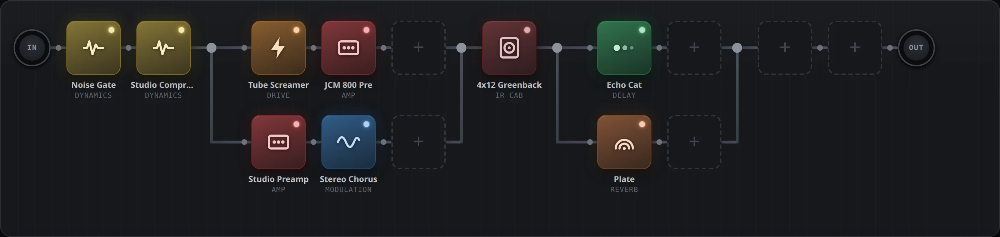

# Alice

**English** · [Italiano](README.it.md) · [Website](https://teopost.github.io/alice/)

Open-source guitar multi-effects with a web interface, built for DIY pedalboards
(Raspberry Pi 5, x86 mini-PCs, any Linux box). Alice runs
[NAM](https://github.com/sdatkinson/neural-amp-modeler) captures and LV2 plugins behind a
block-based interface inspired by Line 6 Helix and Fractal.



> Status: **first version, in development**. Working today: audio engine, block interface with
> 66 effects, parallel paths (also on two rows, Helix style), NAM captures and IRs (including the
> TONE3000 store), presets and offline rendering. Coming next: footswitches/MIDI, snapshots.

## Features

- **Neural Amp Modeler** captures for amps, pedals and full rigs, plus impulse responses for cabs.
- **66 blocks**: overdrives, fuzzes, wahs, dynamics, modulation, delays, reverbs and pitch
  (Guitarix, LSP, Dragonfly), each with a short description and a searchable library.
- **Parallel paths** with up to 6 lanes. Drag the split and merge nodes anywhere on the chain;
  a lane can even extend past the merge node, with its wire returning above its effects.
- **Free grid**: blocks stay in the cell where you drop them; every wire has an anchor node.
- **Optional second row** chained after the first, like linking the two paths on a Helix.
- **TONE3000 store**: browse trending and new community captures and install them with one click.
- **Any device**: the interface is plain JavaScript in the browser, works offline on the
  pedalboard and syncs live between devices.

## Quick start (any PC, no audio interface)

```sh
git clone https://github.com/teopost/alice
cd alice
docker compose up -d --build
```

Open **http://localhost:8090** (from another device: `http://<computer-ip>:8090`).

Without an audio interface JACK runs on a virtual sound card, which is perfect for building
presets. To hear them, open **Prova con file** (test with a file) at the bottom of the page,
load a DI (a clean guitar recording, `.wav`) and press **Ascolta** (listen): the backend runs it through the chain
and the browser plays the result.

Test files (NAM models with random weights, an approximate IR, a synthetic DI):

```sh
python3 scripts/make_test_nam.py data/models
docker exec alice sh /opt/alice/scripts/make_test_ir.sh /data/irs/test-cab.wav
docker exec alice sox -n -r 48000 -c 1 -b 24 /data/di/test.wav synth 8 pluck E2
```

**Playing through the browser**: the **Suona dal browser** drawer captures the guitar from
the PC's audio interface and streams it to the engine over WebSocket. Typical latency is
40–80 ms: fine for auditioning tones, not for playing live. Browsers only allow audio input
from `http://localhost` or over https.

## Installing on Linux with an audio interface

This is the intended setup: the interface is connected to the computer running Alice, and the
browser is only a remote control (laptop, tablet or phone). Latency is a few milliseconds.

1. **Requirements**: Docker with the compose plugin; your user in the `audio` group
   (`sudo usermod -aG audio $USER`, then log in again). For real-time audio, set the CPU
   governor to `performance` and use a `lowlatency` or `PREEMPT_RT` kernel if available.
2. **Find the interface**:
   ```sh
   aplay -l          # e.g. "card 1: Stomp [HX Stomp], device 0"
   ```
   and set `ALICE_ALSA_DEVICE` in `docker-compose.hw.yml` (e.g. `hw:Stomp` or `hw:1`).
3. **Channels**: the chain reads from `ALICE_INPUTS` (default `system:capture_1`) and writes to
   `ALICE_OUTPUTS` (default `system:playback_1,system:playback_2`). List the ports with
   `docker exec alice jack_lsp`.
4. **Start**:
   ```sh
   docker compose -f docker-compose.yml -f docker-compose.hw.yml up -d --build
   docker logs -f alice      # look for "avvio jackd (alsa, ...)" and "Alice pronta"
   ```
5. Open `http://<pc-ip>:8090`. If you hear crackles (xruns in the top bar), raise
   `ALICE_BUFFER_SIZE` to 256.

While Alice uses the interface directly, the desktop's sound server cannot use it. On PipeWire
you can release it with `wpctl set-profile <device-id> 0` (find the id with `wpctl status`).

### Line 6 HX Stomp

The Stomp works well as a USB interface:

- In the Stomp preset, set the **Input** block to **USB 5/6** (the computer sends nothing
  there), so the dry guitar no longer reaches the Stomp's outputs directly.
- The Stomp always sends the **dry DI** signal on a separate USB channel. Find it by playing
  while you check the levels (on the setup Alice was tested with it is `system:capture_5`) and
  set `ALICE_INPUTS` accordingly.
- Alice's output goes back to the Stomp's main outputs and headphone jack.

### Docker as Podman rootless

If `docker` is actually Podman in rootless mode, `docker-compose.hw.yml` fails with
`setrlimit RLIMIT_RTPRIO: Operation not permitted`, and JACK cannot reserve the card through
D-Bus. Add a local override (keep it out of git) and start with all three files:

```yaml
# docker-compose.local.yml
services:
  alice:
    ulimits: !reset {}
    environment:
      JACK_NO_AUDIO_RESERVATION: "1"
      ALICE_ALSA_DEVICE: hw:Stomp
      ALICE_BUFFER_SIZE: 256
```

```sh
docker compose -f docker-compose.yml -f docker-compose.hw.yml -f docker-compose.local.yml up -d
```

Without real-time priority, a 256-sample buffer (about 5 ms) avoids crackles; 128 needs your
user to have an `rtprio` limit (e.g. membership of the `pipewire` or `audio` group with the
right limits).

## TONE3000 store

1. Sign in to [tone3000.com](https://www.tone3000.com), open **Settings → API Keys** and create
   a key. Only the **publishable key** (`t3k_pub_…`) is needed; never use the secret key.
2. In Alice open **Profili NAM** (NAM profiles), paste the key and connect your account (a TONE3000 window
   opens for sign-in).
3. Browse **Di tendenza** (trending), **Novità** (new), your **Preferiti** (favorites) and
   **Scaricati** (downloaded), or open the full catalog
   on TONE3000 and pick a tone: Alice downloads it into its files and loads it into a NAM block.

The key and the account tokens are stored by the engine in `data/state/tone3000.json`
(ignored by git). Loopback addresses (`localhost`) are always accepted as OAuth redirect; to
use the store from another device, register `http://<pc-ip>:8090/t3k/callback` on your key.
With the free API tier, free-text search happens on the TONE3000 site.

## Architecture

A single container with:

- **JACK** (`dummy` driver for development, `alsa` with a real interface);
- **[mod-host](https://github.com/moddevices/mod-host)**, an LV2 host driven over a socket;
- LV2 plugins: **[NAM](https://github.com/mikeoliphant/neural-amp-modeler-lv2)**, LSP,
  Guitarix, Dragonfly;
- **backend** in Python/FastAPI (`backend/alice`): board state, routing, files, presets,
  TONE3000 client, WebSocket with DSP load;
- **audio bridge** (`backend/alice/bridge.py`, port 8091): a separate process that exchanges
  audio with the browser, kept apart from the web server so its JACK callback never waits for
  the GIL;
- **web interface** (`web/`): plain JavaScript with no external dependencies.

The block catalog lives in `backend/alice/catalog.py`: adding an effect only takes its LV2 URI
and the parameters to show.

### Board format

```json
{"name": "Clean", "rows": 1,
 "chain":  [ELEMENT, ...],
 "chain2": [ELEMENT, ...]}
```

An element is a block or a split with parallel lanes:

```json
{"id": "b1", "kind": "block", "model": "ts9", "enabled": true, "gap": 0,
 "params": {"fslider2_": 0.6}, "file": null}

{"id": "s1", "kind": "split", "gap": 0, "span": 2,
 "lanes": [[ELEMENT, ...], [ELEMENT, ...]]}
```

`chain2` is the optional second row, chained after `chain`. `gap` (empty grid cells before an
element) and `span` (the merge node column) only affect the layout. The backend computes the
differences and sends mod-host only the commands needed.

### Main API

| Method | Path | Description |
|---|---|---|
| GET | `/api/catalog` | block categories and models |
| GET, PUT | `/api/board` | current board |
| PATCH | `/api/blocks/{id}` | parameters, on/off, file of a block |
| GET, PUT, DELETE | `/api/files/{kind}[/{name}]` | user files: `nam`, `ir`, `di` (PUT body = file content) |
| GET, PUT, DELETE | `/api/presets[/{name}]` | presets; POST `/api/presets/{name}/load` recalls one |
| POST | `/api/render?di=name.wav` | runs a DI through the chain, returns the WAV |
| GET | `/api/t3k/status`, `/api/t3k/feed/{list}`, `/api/t3k/tones/{id}` | TONE3000 account, lists and tone details |
| POST | `/api/t3k/authorize`, `/api/t3k/install` | start the OAuth flow, install a model |
| WS | `/ws` | status (DSP, xruns) and changes made from other devices |
| WS | port **8091** | audio bridge: mono float32 blocks at 48 kHz in both directions |

`scripts/alice_poc.py` (proof of concept) talks to mod-host directly; mod-host accepts a single
client, so it only works with the backend stopped.

## License

Alice is free software, released under the
[GNU General Public License v3.0](LICENSE). You can use, study, share and modify it; derived
works must be distributed under the same license.
